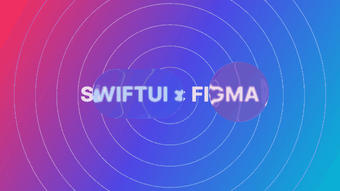
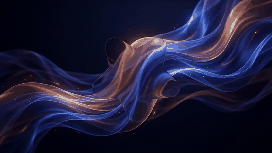
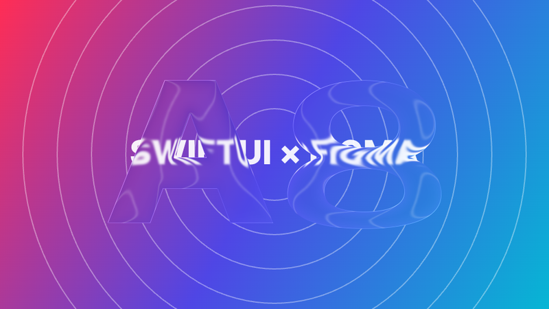
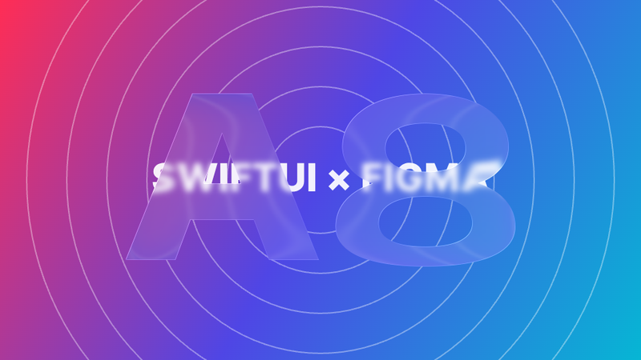
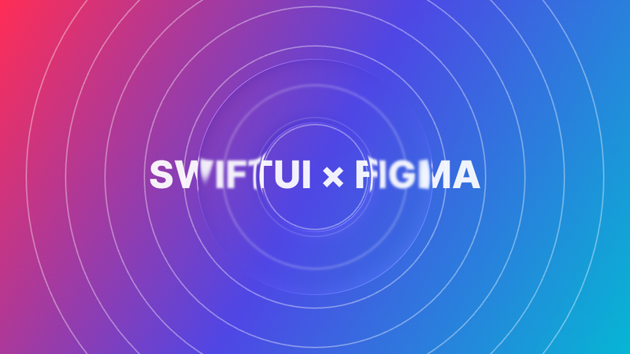
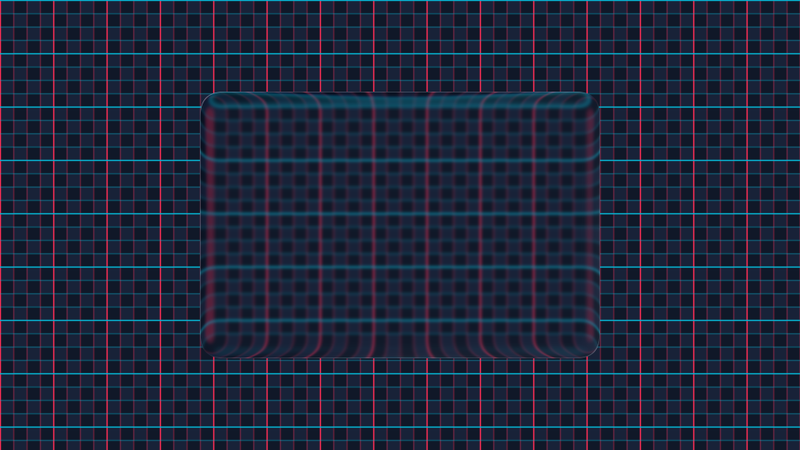

# Liquid-Glass-Flash

**Real-time 60/120 FPS Liquid Glass for Web & React — Zero Dependencies**  
**웹과 React를 위한 무의존성 · 60/120 FPS 실시간 리퀴드 글래스 라이브러리**

`WebGL2 / WebGPU` · `60/120 FPS Video` · `React & Vanilla JS` · `SVG & Variable Fonts` · `Zero Dependencies` · `MIT`

[English](#english) · [한국어](#한국어)

### Live Motion Preview

| Gooey Metaball Merge | Real-Time Shape Morphing |
| :---: | :---: |
|  |  |

### Visual Gallery

| Sculpted 3D Vector / Font | Plate Mode (Video Titles) |
| :---: | :---: |
|  |  |

| Boolean Cutout (Donut) | Optical Edge Refraction |
| :---: | :---: |
|  |  |

---

## English

**Liquid-Glass-Flash** brings physical Liquid Glass optics — smooth edge refraction, chromatic dispersion, directional specular rims, and frosted glass blur — to the browser with a clean, SwiftUI-inspired declarative API.

### Features

- **Physical Glass Optics** — Real-time refraction, RGB chromatic dispersion, directional 1px specular highlights, and frosted backdrop blur.
- **Declarative Presets + Numeric Control** — Start with `regular`, `clear`, or `identity` presets and fine-tune any property on a `0–100` scale.
- **Gooey, Morph & Boolean Shapes** — Merge glass shapes like liquid droplets (`<GlassGroup gooey>`), morph smoothly between primitives, or cut out holes.
- **Crisp Vector SVG & Variable Fonts** — Analytic Bézier rendering for any SVG path or OpenType font, including overlapping Variable Fonts (`Google Sans`, `Inter`, `Pretendard`, CJK).
- **Two Text & Vector Profiles** — Choose `sculpted` for 3D pillowy glass lettering or `plate` for clean, high-legibility titles and subtitles over video.
- **60 / 120 FPS Over Live Video** — Built-in `<video>` frame sync and cached blur pipeline with zero external dependencies.

### Installation

```bash
npm install github:wooni1017/Liquid-Glass-Flash
```

### Quick Start (React)

```jsx
import { useRef } from 'react';
import { GlassScene, Glass, GlassGroup } from 'figma-liquid-glass/react';

export function App() {
  const videoRef = useRef(null);

  return (
    <>
      <video ref={videoRef} src="/bg.mp4" autoPlay loop muted playsInline hidden />

      <GlassScene backdrop={videoRef} width={960} height={540} fps={120}>
        {/* Single glass pill */}
        <Glass
          shape="capsule"
          rect={[240, 180, 480, 180]}
          preset="regular"
          frost={8}
          dispersion={25}
        />

        {/* Gooey metaball merge */}
        <GlassGroup gooey={32}>
          <Glass shape="capsule" rect={[260, 195, 260, 140]} preset="regular" />
          <Glass shape="circle" rect={[495, 185, 170, 170]} preset="clear" tint="#FF2D55/20" />
        </GlassGroup>

        {/* Video-friendly glass text */}
        <Glass
          shape={{ text: 'Liquid Glass', font: loadedFont }}
          rect={[160, 100, 640, 340]}
          profile="plate"
          preset="regular"
          frost={12}
          tint="#FFFFFF/12"
        />
      </GlassScene>
    </>
  );
}
```

### Quick Start (Vanilla JS)

```js
import { compileSceneIR, createGlassRenderer } from 'figma-liquid-glass';

const renderer = createGlassRenderer(document.querySelector('canvas'));
const scene = compileSceneIR([
  { shape: 'rect(32)', rect: [240, 110, 480, 320], preset: 'regular' },
]);

renderer.render(scene, backdropElement);
```

### Props & Options

| Prop | Values | Default | Description |
| :--- | :--- | :--- | :--- |
| `shape` | `'rect(r)'`, `'capsule'`, `'circle'`, `'star'`, `'triangle'`, `'hexagon'`, `{ svg }`, `{ text, font }` | `'capsule'` | Glass shape, SVG path, or font text |
| `profile` | `'sculpted'`, `'plate'` | `'sculpted'` | `sculpted` for 3D glass strokes, `plate` for flat-center video titles |
| `preset` | `'regular'`, `'clear'`, `'identity'` | `'regular'` | Base glass material preset |
| `refraction` | `0 – 100` | `100` | Optical bending strength |
| `depth` | `0 – 100` | `100` | Edge lens bevel depth |
| `dispersion` | `0 – 100` | `20` | RGB chromatic aberration strength |
| `frost` | `0 – 60` | `4` | Frosted backdrop blur amount |
| `splay` | `0 – 100` | `100` | Radial lens splay factor |
| `lightAngle` | `-180° – 180°` | `-45°` | Directional highlight angle |
| `lightIntensity` | `0 – 100` | `80` | Rim highlight and bevel shading strength |
| `tint` | `'#RRGGBB/opacity'` | `'#FFFFFF/0'` | Glass tint color and opacity percentage |

---

## 한국어

**Liquid-Glass-Flash**는 부드러운 가장자리 굴절, RGB 색수차, 지향성 1px 유리 테두리, 프로스트 블러를 SwiftUI처럼 간결한 선언형 API로 웹과 React에 구현해 주는 무의존성 실시간 리퀴드 글래스 라이브러리입니다.

### 주요 기능

- **물리 기반 유리 광학** — 실시간 렌즈 굴절, 대칭 RGB 색수차, 1px 스페큘러 립, 프로스트 배경 블러를 지원합니다.
- **프리셋 + 수치 미세 조정** — `regular`, `clear`, `identity` 프리셋을 기본으로 두고 모든 옵션을 `0–100` 수치로 세밀하게 조정할 수 있습니다.
- **Gooey 합체 · 모핑 · 불리언** — 액체 방울처럼 합쳐지는 `<GlassGroup gooey>`, 도형 간 모핑, 도넛형 구멍 뚫기를 실시간으로 처리합니다.
- **선명한 SVG 및 가변 폰트 지원** — 어떤 SVG 경로나 OpenType 폰트(`Google Sans`, `Inter`, `Pretendard`, 한글 포함)도 깨짐이나 내부 겹침선 없이 깔끔하게 렌더링합니다.
- **두 가지 텍스트/벡터 프로필** — 입체적인 3D 유리 글자용 `sculpted`와, 영상 위 자막·타이틀 가독성에 맞춘 `plate` 모드를 옵션 하나로 전환합니다.
- **실시간 영상 위 60 / 120 FPS** — `<video>` 프레임 자동 동기화와 캐시된 블러 파이프라인을 외부 의존성 없이 내장했습니다.

### 설치

```bash
npm install github:wooni1017/Liquid-Glass-Flash
```

### 빠른 시작 (React)

```jsx
import { useRef } from 'react';
import { GlassScene, Glass, GlassGroup } from 'figma-liquid-glass/react';

export function App() {
  const videoRef = useRef(null);

  return (
    <>
      <video ref={videoRef} src="/bg.mp4" autoPlay loop muted playsInline hidden />

      <GlassScene backdrop={videoRef} width={960} height={540} fps={120}>
        {/* 단일 유리 캡슐 */}
        <Glass
          shape="capsule"
          rect={[240, 180, 480, 180]}
          preset="regular"
          frost={8}
          dispersion={25}
        />

        {/* Gooey 메타볼 합체 */}
        <GlassGroup gooey={32}>
          <Glass shape="capsule" rect={[260, 195, 260, 140]} preset="regular" />
          <Glass shape="circle" rect={[495, 185, 170, 170]} preset="clear" tint="#FF2D55/20" />
        </GlassGroup>

        {/* 영상 자막/타이틀용 유리 텍스트 */}
        <Glass
          shape={{ text: '안녕하세요', font: loadedFont }}
          rect={[160, 100, 640, 340]}
          profile="plate"
          preset="regular"
          frost={12}
          tint="#FFFFFF/12"
        />
      </GlassScene>
    </>
  );
}
```

### 빠른 시작 (Vanilla JS)

```js
import { compileSceneIR, createGlassRenderer } from 'figma-liquid-glass';

const renderer = createGlassRenderer(document.querySelector('canvas'));
const scene = compileSceneIR([
  { shape: 'rect(32)', rect: [240, 110, 480, 320], preset: 'regular' },
]);

renderer.render(scene, backdropElement);
```

### 주요 옵션

| 속성 | 값 / 범위 | 기본값 | 설명 |
| :--- | :--- | :--- | :--- |
| `shape` | `'rect(r)'`, `'capsule'`, `'circle'`, `'star'`, `'triangle'`, `'hexagon'`, `{ svg }`, `{ text, font }` | `'capsule'` | 도형, SVG 경로 또는 폰트 텍스트 |
| `profile` | `'sculpted'`, `'plate'` | `'sculpted'` | `sculpted`(입체 3D 획) 또는 `plate`(영상 타이틀용 평면 중앙) |
| `preset` | `'regular'`, `'clear'`, `'identity'` | `'regular'` | 기본 유리 프리셋 |
| `refraction` | `0 – 100` | `100` | 굴절 강도 |
| `depth` | `0 – 100` | `100` | 가장자리 베벨 깊이 |
| `dispersion` | `0 – 100` | `20` | RGB 색수차 강도 |
| `frost` | `0 – 60` | `4` | 배경 프로스트 블러 강도 |
| `splay` | `0 – 100` | `100` | 방사형 굴절 확산 비율 |
| `lightAngle` | `-180° – 180°` | `-45°` | 광원 각도 |
| `lightIntensity` | `0 – 100` | `80` | 1px 테두리 하이라이트 및 음영 세기 |
| `tint` | `'#RRGGBB/opacity'` | `'#FFFFFF/0'` | 유리 틴트 색상 및 투명도(%) |

---

## License

MIT